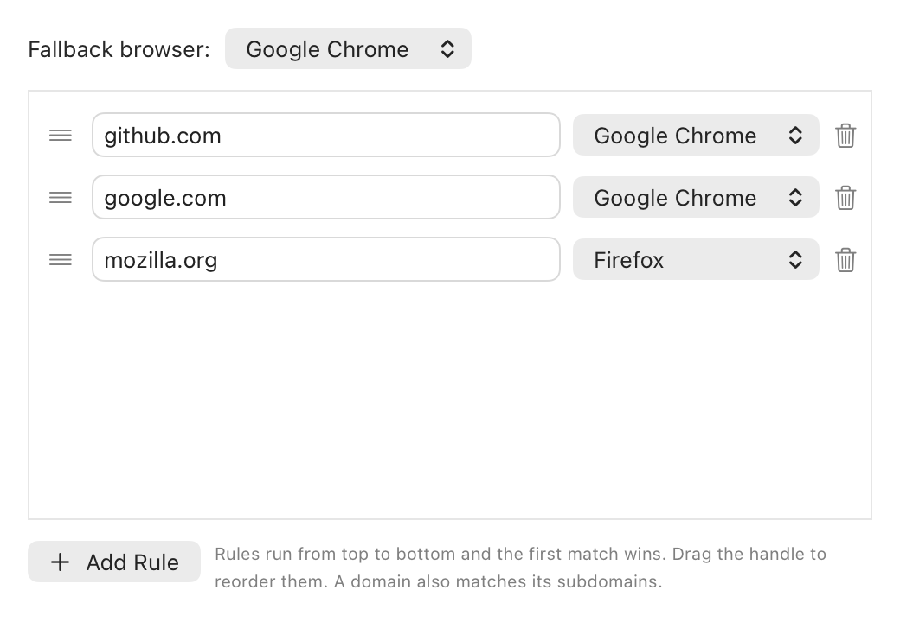

# Switchboard

[](https://github.com/amitkma/switchboard/actions/workflows/ci.yml)

Switchboard is a small macOS menu bar app that opens each link in the browser you choose for that website. Set it as your default browser, add a few rules, and links from any app go to the right place.



## Features

- Route links by domain to any installed browser.
- Rules also cover subdomains, so `github.com` matches `api.github.com`, but never lookalikes such as `notgithub.com` or `github.com.evil.com`.
- Rules run from top to bottom and the first match wins.
- A fallback browser handles everything else.
- If a browser is missing, Switchboard tells you and lets you pick another one.
- Settings stay on your Mac. The app makes no network requests of its own and has no analytics.

## Requirements

- macOS 15 or later (developed and tested on macOS 27.2)
- Xcode 27 or later, only if you build from source

## Download

1. Download the latest `Switchboard-<version>.zip` from [Releases](https://github.com/amitkma/switchboard/releases/latest) and unzip it.
2. Drag `Switchboard.app` to your Applications folder and open it.
3. macOS blocks the app the first time, because it isn't notarized by Apple. Open **System Settings → Privacy & Security**, scroll to **Security**, click **Open Anyway** next to Switchboard, and confirm.
4. Look for the Switchboard icon in the menu bar, then [set it as your default browser](#set-it-as-your-default-browser).

The app has no automatic updates, so check Releases for new versions. Each release includes a `SHA256SUMS.txt` file for verifying your download. If you'd rather not bypass the warning, you can build it from source.

## Build from source

1. Clone this repository and open `Switchboard.xcodeproj` in Xcode.
2. Select the **Switchboard** scheme and **My Mac**.
3. Press **⌘R**. The app has no Dock icon, so look for its icon in the menu bar.

You don't need a paid Apple Developer account to run it on your own Mac. To keep a signature that stays the same between builds, choose your Apple ID under **Signing & Capabilities → Team**.

To install it permanently, choose **Product → Show Build Folder in Finder**, drag `Products/Debug/Switchboard.app` to `/Applications`, then choose **Product → Clean Build Folder** so that macOS doesn't launch the old copy.

## Set it as your default browser

The first time you open Switchboard, its settings window explains this step.

1. Click **Set as Default**. You can also find **Set as Default Browser…** in the menu bar menu.
2. Confirm the change when macOS asks. macOS doesn't let an app take this role without asking you.
3. Edit your rules in the settings window. To reopen it later, click the menu bar icon and choose **Settings…**.

To change it by hand, or to switch back, open **System Settings → Desktop & Dock → Default web browser**. If it isn't there, search System Settings for "default web browser".

## Good to know

- These always go to the fallback browser: local HTML files, IPv6 addresses, and links with embedded logins such as `https://user@github.com`. Browsers and URL parsers can disagree about the real host of a link with a login in it, so skipping the rules is the safe choice.
- An app is listed as a browser if it handles both `https` links and HTML files.
- Browsers kept outside the usual app folders might not be listed.

## Tests

```sh
xcodebuild -project Switchboard.xcodeproj -scheme Switchboard -destination 'platform=macOS,arch=arm64' test
```

## License

[MIT](LICENSE)
